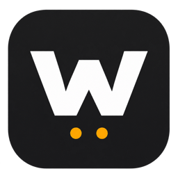
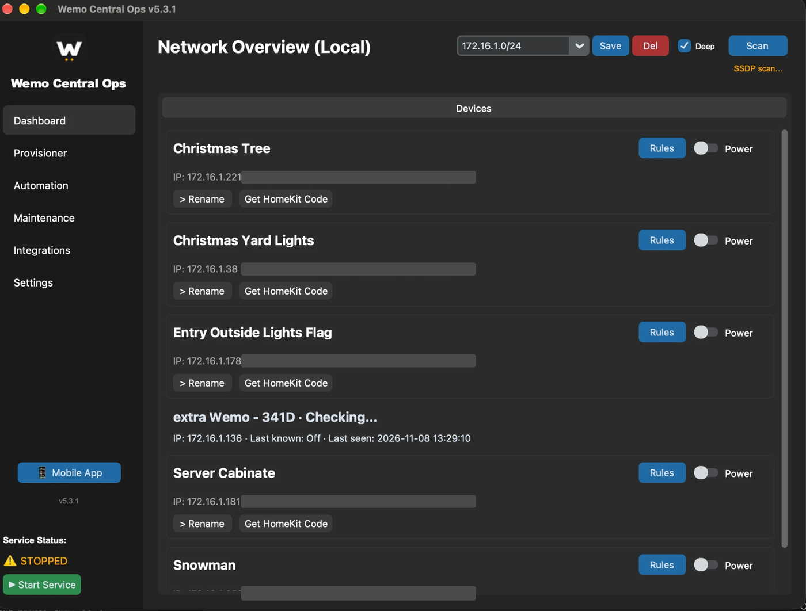
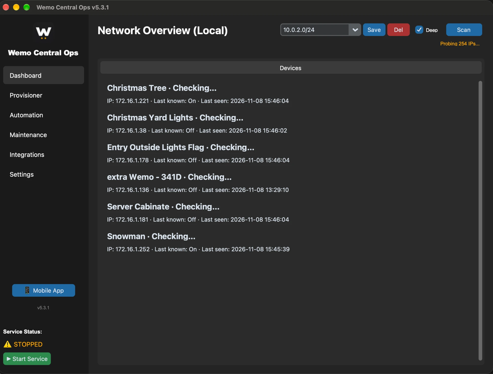
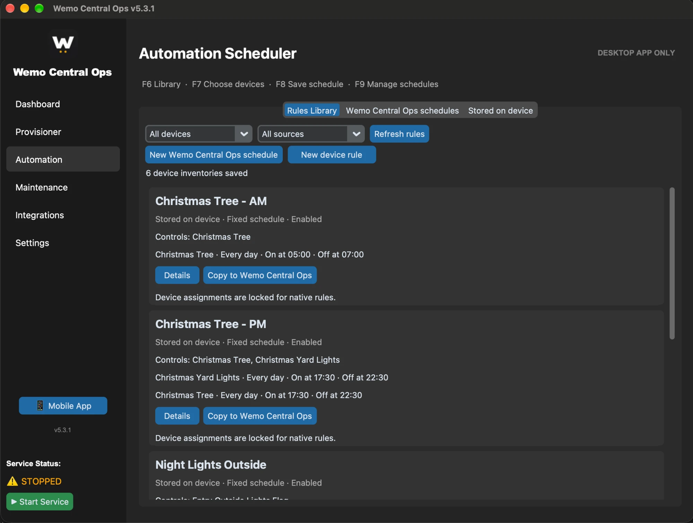
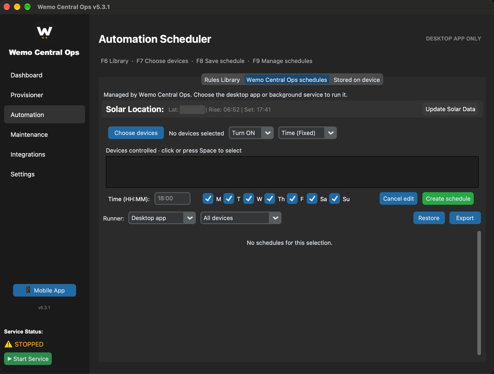
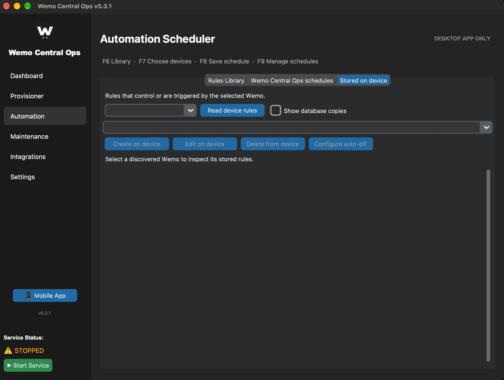
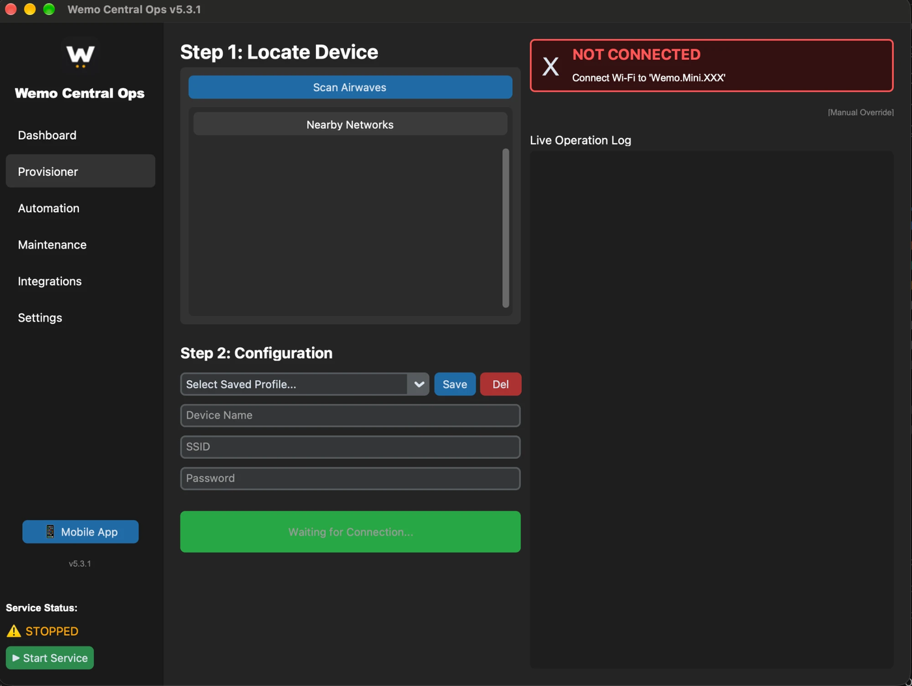
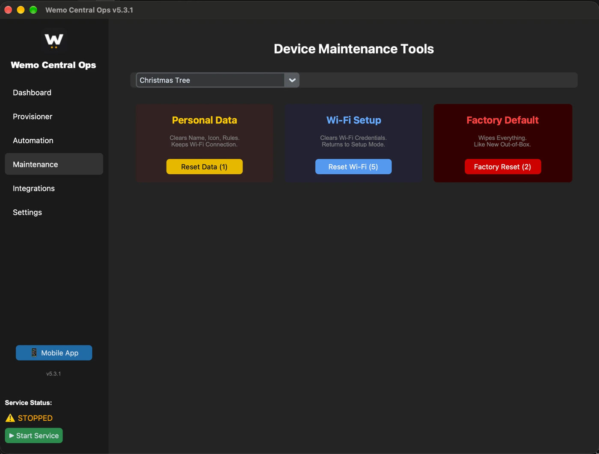

<p align="center">
  
</p>

# Wemo Central Ops

[](LICENSE)
[](ROADMAP.md)
[](#requirements)
[](https://www.python.org/downloads/macos/)
[](https://github.com/qrussell/wemo-ops-center)

> **A fully local macOS control plane for Belkin Wemo devices — discover, control, schedule, and edit on-device rules with no cloud account and no vendor app. The Wemo cloud is dead; your hardware does not have to be.**

Belkin shut down the Wemo cloud, stranding plugs and switches that still work
perfectly. Wemo Central Ops talks to them directly over your LAN — discovery,
on/off, dimming, renaming, scheduling, and read/write access to the rules
stored on the device itself. Nothing leaves your network.

It is an independent fork of [Wemo Ops Center](https://github.com/qrussell/wemo-ops-center)
by Quentin Russell and its contributors, based on upstream commit `58f4915`.

---

## Table of Contents

- [What you get](#what-you-get)
- [Backstory — why this fork exists](#backstory--why-this-fork-exists)
- [Evolution of this tool](#evolution-of-this-tool)
- [Five-minute Quick Start](#five-minute-quick-start)
- [Screenshots](#screenshots)
- [Features at a glance](#features-at-a-glance)
- [Why this fork exists (benefits)](#why-this-fork-exists-benefits)
- [Requirements](#requirements)
- [Build guide](#build-guide)
- [Keyboard shortcuts](#keyboard-shortcuts)
- [Backup & restore](#backup--restore)
- [Troubleshooting](#troubleshooting)
- [Repo layout](#repo-layout)
- [Important notes](#important-notes)
- [Contributing](#contributing)
- [License & credits](#license--credits)
- [Keywords](#keywords)

---

## What you get

- **A dashboard that fills in seconds, not minutes.** Saved devices render
  immediately and verify in the background. Devices that miss a scan stay
  listed with their last-seen time instead of vanishing.
- **Discovery that understands your network.** Uses the real Wi-Fi or
  Ethernet IPv4 subnet and mask, and ignores VPN tunnels when picking it.
- **A Rules Library.** Reads and caches rules from reachable Wemos, groups
  matching copies, and shows which devices a rule **Controls** versus where
  it was **Found on**.
- **Managed schedules across several devices.** One schedule can drive
  multiple Wemos, run in the desktop app or in the background service, and
  reports its next run and last result.
- **On-device rule editing.** Read, create, edit, and delete supported
  single-device fixed schedules and auto-off countdowns, with a backup and a
  verify pass on every write.
- **Dimmer support.** 0–100% brightness on compatible switches.
- **A signed macOS app.** One build script produces a verified, signed bundle
  and an architecture-labelled DMG.

---

## Backstory — why this fork exists

Upstream v5.3.0 shipped two defects that made the macOS build effectively
unusable, both reported in
[issue #21](https://github.com/qrussell/wemo-ops-center/issues/21):

**The app would not launch.** Nothing in the build was code-signed. On Apple
Silicon an invalid signature produces *"WemoOps is damaged and can't be
opened"* — which reads to users as a corrupt download, so they delete it. A
second path to the same dead end: if the building Python lacked Tk, PyInstaller
silently omitted `tkinter` and the app died with `ModuleNotFoundError`.

**The dashboard took minutes.** v5.3.0 removed the deep-scan gate and the
background-service fast path from the scan routine, so every refresh ran a
full TCP sweep of the subnet. The verification stage was sequential at
pywemo's default **10-second** timeout — and ports 49152–49155 are the generic
UPnP range, so routers, printers and NAS boxes all answer there. Each
non-Wemo responder cost up to 40 seconds, in series. A 10-second refresh
became 2:50 on an M1 and
[300+ seconds on Windows](https://github.com/qrussell/wemo-ops-center/issues/25).

Both are fixed here, along with the macOS packaging, the mixed-encoding
`.gitignore` and `requirements.txt`, and the three divergent build scripts.

---

## Evolution of this tool

| | Wemo Ops Center (upstream `58f4915`) | Wemo Central Ops (`5.3.2`) |
|---|---|---|
| Launches on Apple Silicon | ❌ reports "damaged" | ✅ signed and verified in the build |
| Dashboard fill time | 2:50 on M1 | ~5s |
| Subnet probe phase (/24, measured) | 12.0s | 2.9s |
| Deep scan | always on, no opt-out | gated, on by default, toggleable |
| Background-service fast path | removed | restored, with local fallback |
| Scan progress feedback | label frozen during scan | live per-stage status |
| VPN interfaces | included in subnet detection | skipped |
| Device cache | none | survives restarts, keeps offline devices |
| Rules Library | ❌ | ✅ grouped, with Controls / Found on |
| Multi-device schedules | ❌ | ✅ desktop or background service |
| On-device rule editing | ❌ | ✅ fixed schedules + auto-off countdowns |
| Schedule backup / restore | ❌ | ✅ JSON, restores paused |
| macOS build scripts | 3, divergent (5.1.6 / 5.3.0 / 5.3.0-1) | 1, with preflight and signing |
| DMG naming | `_tahoe` / `_universal`, neither universal2 | named for the architecture it contains |
| `tkinter` preflight | ❌ silent failure | ✅ fails early with the fix |

> See [`ROADMAP.md`](ROADMAP.md) for dated status, rationale, verification notes
> and open issues.

---

## Five-minute Quick Start

### Install the DMG

1. Open the Apple Silicon DMG and drag **Wemo Central Ops.app** onto
   **Applications**.
2. First launch: right-click the app → **Open** → **Open** again. The build is
   signed but not notarized, so Gatekeeper asks once. See
   [Troubleshooting](#troubleshooting).
3. Open **Dashboard**. Devices appear from cache immediately and verify in the
   background. **Scan** refreshes discovery or scans a subnet you type in.

### Build from source

```bash
bash universal-app/build_mac.sh --python /opt/homebrew/bin/python3.14
```

Output: `universal-app/dist/WemoCentralOps_5.3.2_arm64.dmg`

### Run schedules after closing the app

Run `Install_WemoCentralOps.command` from the DMG. It copies the app, clears
the download quarantine flag, and registers the background service as a login
agent on port **5050**. Then pick that service as the runner for a schedule.

---

## Screenshots

> Device MAC addresses, serial numbers and the solar latitude are redacted.
> Private-range IPs are left visible.

### Dashboard — every Wemo on one screen

Power toggle, per-device **Rules**, rename, and HomeKit code retrieval. Devices
that missed the last scan stay listed with their last known state and last-seen
time instead of disappearing — *extra Wemo - 341D* below is one of those.



### Deep scan — the part that used to take 2:50

**Probing 254 IPs** across a /24 while the cached devices stay on screen and
re-verify in the background. The probe phase of this sweep measures 2.9s,
against 12.0s before the fix.



### Rules Library — what controls what

Rules read from the devices themselves, grouped by matching copy. Each card
separates what a rule **Controls** from where it was found, and offers **Copy
to Wemo Central Ops** to turn a native rule into a managed schedule.



### Managed schedules — multi-device, with a choice of runner

Fixed-time or solar-relative triggers across any set of devices. **Runner**
selects the desktop app or the background service, so schedules keep firing
after the app is closed. Export and Restore handle backups.



### Stored on device — edit the rules on the Wemo itself

Read, create, edit and delete the rules held in the device's own database,
including auto-off countdowns. These keep running whether or not this app is
ever opened again.



### Provisioner — set up a factory-fresh Wemo without the vendor app

Scans for a device broadcasting its `Wemo.*` setup SSID, then writes your
Wi-Fi credentials to it directly.



### Maintenance — reset without the cloud

Three scopes: clear name, icon and rules; clear Wi-Fi credentials and return to
setup mode; or a full factory wipe.



---

## Features at a glance

| Area | Detail |
|---|---|
| Discovery | SSDP plus a gated parallel TCP sweep. Real interface subnet and mask, VPN tunnels skipped. Manually entered subnets are preserved. |
| Dashboard | Cached devices render instantly, read-only until background verification confirms UDN and power state. Rescans merge by UDN. |
| Control | On/off toggle, 0–100% dimmer slider on compatible devices, rename. IP, MAC, firmware, serial and HomeKit code shown. |
| Rules Library | Cached device rules grouped by matching copy, separating controlling from triggering devices. |
| Managed schedules | Multi-device, desktop or service runner, next-run and last-result reporting, duplicate prevention. |
| Device rules | Fixed on/off intervals and auto-off countdowns written back to the device, with backup and verify. Shared or conflicting copies are view-only. |
| Background service | Flask app on port 5050, its own schedule store with edit, pause, status and batch restore. |
| Integrations | HOOBS / Homebridge config generation for HomeKit, Alexa and Google Home bridging. |
| Packaging | PyInstaller bundle, ad-hoc or Developer ID signing, signature verification, arch-labelled DMG. |

---

## Why this fork exists (benefits)

- **Your hardware keeps working.** No cloud account, no vendor app, no
  telemetry, no subscription. Devices that Belkin orphaned stay useful.
- **It opens and it is fast.** The two defects that made the upstream macOS
  build unusable are fixed and measured, not assumed.
- **Schedules survive the app closing.** The background service runs them.
- **Rules live where they belong.** On-device rules keep running even if this
  app is never opened again.
- **Nothing leaves your LAN.** All discovery and control is local.

---

## Requirements

| | |
|---|---|
| OS | macOS. Verified on macOS 27.3, Apple Silicon (arm64) |
| Python (to build) | 3.11 or later **with a working Tk** |
| Tk | `brew install python-tk@3.14`, or use a python.org build |
| Tools | `hdiutil`, `codesign`, `lipo` (all ship with macOS / Xcode CLT) |
| Devices | Belkin Wemo plugs, switches and dimmers on the same LAN |

Running the prebuilt DMG needs none of the above — Python and Tk are bundled.

---

## Build guide

```bash
# native architecture, ad-hoc signed
bash universal-app/build_mac.sh

# pick the interpreter explicitly
bash universal-app/build_mac.sh --python /opt/homebrew/bin/python3.14

# true universal2 (needs a python.org universal2 interpreter)
bash universal-app/build_mac.sh --arch universal2

# signed with a real Developer ID, ready for notarization
bash universal-app/build_mac.sh --sign "Developer ID Application: Name (TEAMID)"
```

The script preflights `tkinter` and the interpreter version, builds the service
binary and signs it *before* nesting it in the app bundle, re-seals the bundle,
verifies the signature, and only then packages the DMG. It recreates its build
and output directories, so build from a scratch copy to preserve earlier
artifacts. Git ignores the DMG so it can be attached to a release separately.

Verify a build by hand:

```bash
codesign --verify --deep --strict universal-app/dist/"Wemo Central Ops.app"
lipo -archs universal-app/dist/"Wemo Central Ops.app"/Contents/MacOS/*
hdiutil verify universal-app/dist/WemoCentralOps_5.3.2_arm64.dmg
```

---

## Keyboard shortcuts

| Key | Action |
|---|---|
| `F6` | Open the managed Rules Library |
| `F7` | Open the device picker |
| `F8` | Save |
| `F9` | Open schedule management |

---

## Backup & restore

Managed schedules export to JSON. Restored schedules arrive **paused** so you
can confirm device assignments before anything fires: restore into the runner
you want, fix any missing device with **Edit**, then resume the rule.

Rules stored on the device are outside the schedule backup format — they live
on the Wemo and are edited through **Stored on device**.

The app keeps its data in `~/Library/Application Support/WemoOps`, retained
from upstream so existing settings, schedules and caches carry over.

---

## Troubleshooting

**"Wemo Central Ops is damaged and can't be opened"**
You have a build older than 5.3.1, where the bundle was unsigned. That message
means an invalid signature, not a failed download. Rebuild or get a newer DMG.

**"cannot be opened because the developer cannot be verified"**
Expected. The build is signed but not notarized, which needs a paid Apple
Developer ID. Any one of these clears it:
right-click the app → **Open** → **Open**; **System Settings → Privacy &
Security → Open Anyway**; or run `Install_WemoCentralOps.command` from the DMG.

**The app builds but dies instantly**
Your build Python has no Tk. Confirm with
`python3.14 -c "import tkinter; print(tkinter.TkVersion)"` and install
`python-tk@<version>`. The build script now refuses to start without it.

**Scanning is slow**
Turn off **Deep** on the dashboard to use SSDP only. Note that
`pywemo.discover_devices()` still pays a 10-second timeout per stale SSDP
announcement — tracked in [`ROADMAP.md`](ROADMAP.md).

**A device is missing after provisioning**
Scan the subnet explicitly with **Deep** on. Some Wemos stop answering
multicast until power-cycled, which is why the deep sweep also runs
automatically when SSDP returns nothing.

---

## Repo layout

```
universal-app/              the live macOS app — build from here
  wemo_ops_universal.py     desktop app: dashboard, automation UI, scheduler
  wemo_server.py            bundled Flask background service (port 5050)
  wemo_schedules.py         shared schedule validation, storage, due times
  wemo_rule_library.py      groups cached device rules for the library view
  wemo_native_rules.py      reads and writes rules stored on the device
  build_mac.sh              build, sign, verify, package
  images/                   app icons
universal-server/           headless server variant
assets/                     logo and baseline screenshots
mac/ windows/ linux/ universal/   earlier per-platform trees, not built
ROADMAP.md                  dated status, rationale, open issues
LICENSING.md                licence scope for fork vs upstream code
```

---

## Important notes

- **Scope.** This fork targets macOS. The other top-level platform folders are
  upstream's earlier implementations and are not part of the build.
- **Hardware verification is partial.** Discovery and reading rules off real
  Wemos are confirmed on hardware — the screenshots above are six live devices
  on a real LAN. Automation and scheduling otherwise passed smoke tests with
  simulated devices. Still untested on hardware: VPN-active discovery, a
  desktop schedule firing, a service schedule firing with the app closed, and
  writing a rule back to a device.
- **Not notarized.** Ad-hoc signing is as far as this goes without a paid
  Apple Developer ID.
- **Bundled dependencies carry their own terms.** Review the dependency
  notices before distributing a build.

---

## Contributing

Issues and pull requests are welcome. Before opening one:

- Read [`ROADMAP.md`](ROADMAP.md) for current status and what is already known.
- Build and run on your own hardware, and say which Mac and macOS version.
- Commit subjects use conventional commits — `type(scope): description`.
- Keep macOS changes inside `universal-app/`. The older platform trees are
  not built and changes there will not ship.

Upstream bugs that are not specific to this fork are better reported to
[qrussell/wemo-ops-center](https://github.com/qrussell/wemo-ops-center/issues).

---

## License & credits

Original contributions to **Wemo Central Ops** are offered under the
[Apache License 2.0](LICENSE), to the extent the fork's contributors have the
right to license them. See [`NOTICE`](NOTICE) for attribution.

This project incorporates code from Quentin Russell's
[Wemo Ops Center](https://github.com/qrussell/wemo-ops-center), based on
upstream commit `58f4915`. **The upstream licence scope is unresolved:** the
upstream README displays an MIT badge and the tree carries an MIT licence for
its MCP materials in `mcp/LICENSE`, but that baseline has no root licence file.
A badge is not a grant. The Apache licence on fork contributions does not
replace upstream terms or grant rights to upstream code and assets.

**Confirm the upstream licence scope and applicable copyright notices before
redistributing a source fork or a binary.** Read [`LICENSING.md`](LICENSING.md)
first.

Credit where it is due: Quentin Russell and the upstream contributors built the
tool this fork stands on, and `pywemo` does the protocol work.

---

## Keywords

Wemo, Belkin Wemo, Wemo cloud shutdown, Wemo local control, Wemo without
cloud, Wemo macOS app, Apple Silicon Wemo, Wemo smart plug, Wemo dimmer,
Wemo scheduling, Wemo rules, Wemo automation, pywemo, HOOBS, Homebridge,
HomeKit bridge, local-first smart home, no-cloud smart home, Wemo provisioning,
Wemo factory reset, Wemo discovery, SSDP, UPnP.
