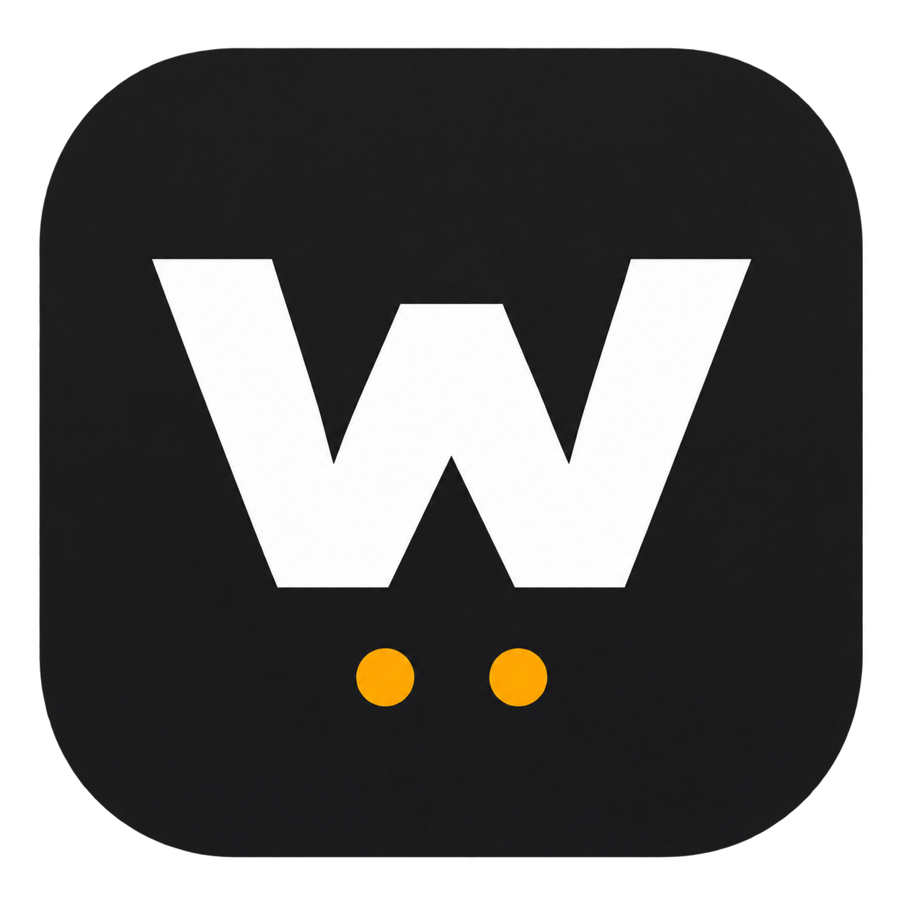

# Wemo Central Ops



Wemo Central Ops is a macOS desktop app for discovering, controlling, and
automating Belkin Wemo devices on your local network. It's an independent
fork of [Wemo Ops Center](https://github.com/qrussell/wemo-ops-center) by
Quentin Russell and its contributors, based on upstream commit `58f4915`.

## What changed from Wemo Ops Center

| Area | Wemo Central Ops |
| --- | --- |
| Discovery | Uses the actual Wi-Fi or Ethernet IPv4 subnet, ignores VPN tunnels when choosing that subnet, and remembers previously discovered devices. |
| Dashboard | Shows saved devices immediately and verifies them in the background. Devices that miss a scan remain listed with their last-seen time. |
| Rules Library | Reads and caches rules from reachable Wemos, groups matching copies, and shows which devices a rule **Controls** and where it was **Found on**. |
| Managed schedules | One schedule can control several Wemos. Run it in the desktop app or the updated background service. See the next run and last result. |
| Device rules | Read, create, edit, and delete supported single-device fixed schedules and auto-off countdowns. Writes back up and verify the rules database. Shared and conflicting copies are view-only in the library. |
| Backup and restore | Export managed schedules to JSON. Restored schedules start paused so you can check device assignments. |
| Keyboard controls | F6 opens the managed Rules Library, F7 opens the device picker, F8 saves, and F9 opens schedule management. |
| Mac packaging | A single build script packages and verifies the signed app and creates an architecture-labeled DMG. |

## Use the app

1. Open the Apple Silicon DMG and drag **Wemo Central Ops.app** into
   **Applications**. The local test build uses ad-hoc signing. Apple
   notarization is a separate release step.
2. Open **Dashboard** to see discovered devices. Use **Scan** to refresh
   discovery or to scan a manually entered subnet.
3. Open **Automation → Rules Library** to browse rules by device or source.
   For a new managed schedule, choose **New Wemo Central Ops schedule**,
   then **Choose devices**. Check the devices you want and save.
4. To configure a native auto-off timer, open **Stored on device**, select
   your Wemo, read its rules, then choose **Configure auto-off**.

Desktop schedules run while the app is open. To run schedules after closing
the app, install and start the bundled background service and choose it as
the runner. The desktop retains the existing data directory at
`~/Library/Application Support/WemoOps` so prior settings, schedules, and
caches carry over.

## Build for Apple Silicon

Run from the repository root on an Apple Silicon Mac with Python 3.11 or
later and a working Tk installation. The build installs its dependencies
in a temporary build environment inside `universal-app`.

```bash
bash universal-app/build_mac.sh --python /opt/homebrew/bin/python3.14
```

The output is `universal-app/dist/WemoCentralOps_5.3.1_arm64.dmg`.
The script recreates its build and output directories. Build from a
scratch copy if you need to preserve prior artifacts. Git ignores the
DMG so it can be attached to a release separately.

Update checks stay off until a release repository is configured. Set
`WEMO_CENTRAL_OPS_RELEASE_REPO` to an `owner/repo` value for the app process
after the new repository has releases.

## Credits and licensing

Thanks to [Quentin Russell and the Wemo Ops Center contributors](https://github.com/qrussell/wemo-ops-center)
for the original app. Original fork contributions use Apache 2.0. See
[NOTICE](NOTICE) and [LICENSING.md](LICENSING.md) for attribution, upstream
license scope, and the public distribution checks.
